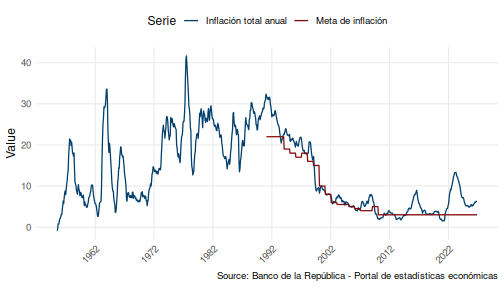
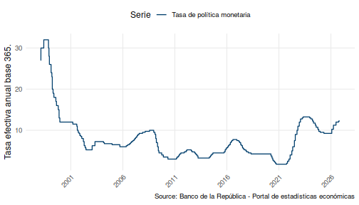
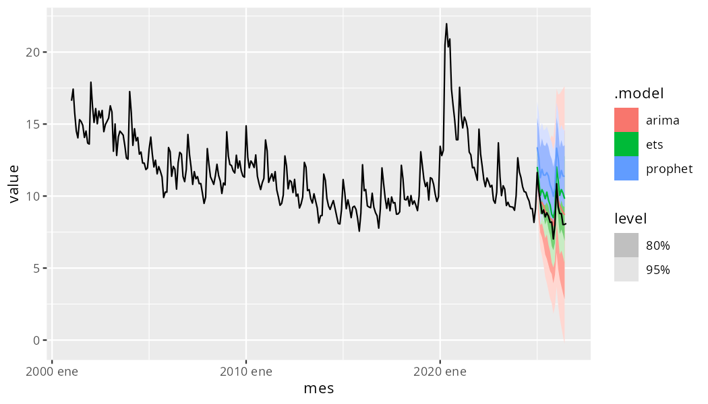

`banrepstats` downloads economic time series from Banco de la República's
(Colombia's central bank) public statistics API — the same data behind its
[SUAMECA](https://suameca.banrep.gov.co/estadisticas-economicas/#/) portal —
and returns them as tidy `data.table` objects, ready to explore or plot.

This vignette walks through the functions the package exports:

- `catalogo_banrep()`, to browse the indicator catalog,
- `search_banrep()`, to search the catalog by keyword,
- `banrep_data()`, to download one or more indicators, and
- `series_plot()`, to plot the result.

## Installation

Install the released version from CRAN with:

```r
install.packages("banrepstats")
```

or the development version from GitHub with:

```r
# install.packages("remotes")
remotes::install_github("fersalme/banrepstats")
```


``` r
library(banrepstats)
```

## Browsing the indicator catalog

Banco de la República organizes its indicators in a menu tree (topic ->
sub-topic -> indicator). `catalogo_banrep()` downloads that tree from the
live API and flattens it into a single table, one row per indicator:


``` r
catalogo <- catalogo_banrep()
nrow(catalogo)
#> [1] 61
head(catalogo)
#>    idGrupo         NombreGrupo idSerie
#>      <int>              <char>   <int>
#> 1:    1000 Precios e inflación  100001
#> 2:    1000 Precios e inflación  100002
#> 3:    1000 Precios e inflación  100003
#> 4:    1000 Precios e inflación  100004
#> 5:    1000 Precios e inflación  100008
#> 6:    1000 Precios e inflación  100005
#>                                      NombreSerie
#>                                           <char>
#> 1:                              Inflación y meta
#> 2:           IPC_Índice de Precios al Consumidor
#> 3:           IPP_Índice de Precios del Productor
#> 4:   IPVU_Índice de precios de la vivienda usada
#> 5: IPVNBR_Índice de precios de la vivienda nueva
#> 6:                      UVR_Unidad de valor real
#>                          idNombreSerie
#>                                 <char>
#> 1:                    inflacion_y_meta
#> 2: indice_de_precios_al_consumidor_ipc
#> 3:  indice_de_precios_al_productor_ipp
#> 4:  indice_precios_vivienda_usada_ipvu
#> 5:  indice_precios_vivienda_nueva_ipvn
#> 6:               unidad_valor_real_uvr
```

Each row is one indicator:

- `idGrupo` / `NombreGrupo`: the id and name of the parent topic (e.g.
  "Precios e inflación").
- `idSerie` / `NombreSerie`: the id and human-readable name of the
  indicator itself (e.g. "Inflación y meta").
- `idNombreSerie`: the indicator's unique code. This is the value you
  pass to `banrep_data()`.

For example, "Inflación y meta" (under the "Precios e inflación" topic)
has the code `"inflacion_y_meta"`:


``` r
subset(catalogo, idNombreSerie == "inflacion_y_meta")
#>    idGrupo         NombreGrupo idSerie      NombreSerie    idNombreSerie
#>      <int>              <char>   <int>           <char>           <char>
#> 1:    1000 Precios e inflación  100001 Inflación y meta inflacion_y_meta
```

Not sure which code you need? `search_banrep()` looks up a keyword
against the topic names, indicator names and codes. The match is partial
and ignores case and accents, so `"inflacion"` also finds "Inflación":


``` r
search_banrep("inflacion")[, .(NombreGrupo, NombreSerie, idNombreSerie)]
#>            NombreGrupo                                   NombreSerie
#>                 <char>                                        <char>
#> 1: Precios e inflación                              Inflación y meta
#> 2: Precios e inflación           IPC_Índice de Precios al Consumidor
#> 3: Precios e inflación           IPP_Índice de Precios del Productor
#> 4: Precios e inflación   IPVU_Índice de precios de la vivienda usada
#> 5: Precios e inflación IPVNBR_Índice de precios de la vivienda nueva
#> 6: Precios e inflación                      UVR_Unidad de valor real
#> 7: Precios e inflación                              Inflación básica
#>                          idNombreSerie
#>                                 <char>
#> 1:                    inflacion_y_meta
#> 2: indice_de_precios_al_consumidor_ipc
#> 3:  indice_de_precios_al_productor_ipp
#> 4:  indice_precios_vivienda_usada_ipvu
#> 5:  indice_precios_vivienda_nueva_ipvn
#> 6:               unidad_valor_real_uvr
#> 7:                    inflacion_basica
```

The keyword is matched as literal text; pass `fixed = FALSE` to use a
regular expression instead. `search_banrep()` also accepts a `cache`
argument, with the same meaning as in `banrep_data()` (see below).

## Downloading data

Pass one of those codes to `banrep_data()` to download the underlying
series as a single `data.table`:


``` r
precios <- banrep_data(indicator = "inflacion_y_meta")
head(precios)
#>                   id     unidad periodicidad       date value
#>               <char>     <char>       <char>     <Date> <num>
#> 1: Meta de inflación Porcentaje        Anual 1955-07-31    NA
#> 2: Meta de inflación Porcentaje        Anual 1955-08-31    NA
#> 3: Meta de inflación Porcentaje        Anual 1955-09-30    NA
#> 4: Meta de inflación Porcentaje        Anual 1955-10-31    NA
#> 5: Meta de inflación Porcentaje        Anual 1955-11-30    NA
#> 6: Meta de inflación Porcentaje        Anual 1955-12-31    NA
```

Each row is one observation of one series:

- `id`: the series name (e.g. "Meta de inflación").
- `unidad`: the unit of measurement (e.g. "Porcentaje").
- `periodicidad`: the reporting frequency (e.g. "Anual", "Mensual").
- `date` / `value`: the observation date and its value.

A single indicator can still bundle more than one related series —
notice how `"inflacion_y_meta"` alone already returns two:


``` r
unique(precios$id)
#> [1] "Meta de inflación"     "Inflación total anual"
```

### Multiple indicators at once

`indicator` accepts a vector of codes; the results come back stacked in a
single `data.table`:


``` r
datos <- banrep_data(c("inflacion_y_meta", "tasas_interes_politica_monetaria"))
unique(datos$id)
#> [1] "Meta de inflación"          "Inflación total anual"     
#> [3] "Tasa de política monetaria"
```

### Restricting the date range

The API always returns each indicator's full history. `start` and `end`
(both inclusive) keep only the observations you need:


``` r
recientes <- banrep_data("inflacion_y_meta", start = "2020-01-01")
range(recientes$date)
#> [1] "2020-01-31" "2026-10-31"
```

### Invalid indicator codes

Passing a code that isn't in the catalog raises an error naming the
invalid codes:


``` r
banrep_data("NO_EXISTE", cache = banrep_cache)
#> Error in `banrep_data()`:
#> ! Invalid indicator code(s): 'NO_EXISTE'.
#> Use search_banrep() or catalogo_banrep() to find valid codes (column 'idNombreSerie').
```

### Using the bundled catalog snapshot

`banrep_data()` calls `catalogo_banrep()` internally to validate the
indicator code and look up its id, which means every call hits the
catalog endpoint. If you're downloading many indicators, or don't need
the live catalog, fetch it once and pass it in via `cache`:


``` r
precios_cache <- banrep_data("inflacion_y_meta", cache = catalogo)
identical(precios$value, precios_cache$value)
#> [1] TRUE
```

The package also bundles a snapshot of the catalog as `banrep_cache`, so
you can look indicators up offline without calling `catalogo_banrep()` at
all:


``` r
head(banrep_cache)
#>    idGrupo         NombreGrupo idSerie
#>      <int>              <char>   <int>
#> 1:    1000 Precios e inflación  100001
#> 2:    1000 Precios e inflación  100002
#> 3:    1000 Precios e inflación  100003
#> 4:    1000 Precios e inflación  100004
#> 5:    1000 Precios e inflación  100008
#> 6:    1000 Precios e inflación  100005
#>                                      NombreSerie
#>                                           <char>
#> 1:                              Inflación y meta
#> 2:           IPC_Índice de Precios al Consumidor
#> 3:           IPP_Índice de Precios del Productor
#> 4:   IPVU_Índice de precios de la vivienda usada
#> 5: IPVNBR_Índice de precios de la vivienda nueva
#> 6:                      UVR_Unidad de valor real
#>                          idNombreSerie
#>                                 <char>
#> 1:                    inflacion_y_meta
#> 2: indice_de_precios_al_consumidor_ipc
#> 3:  indice_de_precios_al_productor_ipp
#> 4:  indice_precios_vivienda_usada_ipvu
#> 5:  indice_precios_vivienda_nueva_ipvn
#> 6:               unidad_valor_real_uvr
```

## Plotting a series

`series_plot()` takes the `data.table` returned by `banrep_data()` and
draws one line per distinct series (the `id` column), colored with the
package's Banco de la República-inspired palette:


``` r
series_plot(precios)
#> Warning: Removed 426 rows containing missing values or values outside the scale range
#> (`geom_line()`).
```



Series with different units are still placed on the same panel, so
`series_plot()` is best used with indicators that share a unit of
measurement:


``` r
tasas <- banrep_data("tasas_interes_politica_monetaria")
series_plot(tasas)
```



## Integrate with time-series forecasting packages

`banrep_data()` returns a plain `data.table`, not a `tsibble`, so it plugs
into the [tidyverts](https://tidyverts.org/) forecasting ecosystem
(`tsibble`, `fable`, `fable.prophet`) with one conversion step: turn the
`date` column into an explicit time index and declare the series with
`as_tsibble()`.

These packages are not dependencies of `banrepstats`, so this example is
not run when the vignette is built — install `tsibble`, `fable`,
`fable.prophet` and `feasts` yourself to try it. The plot below is a
pre-rendered snapshot of the code's output.


``` r
library(dplyr)
library(tsibble)
library(fable)
library(fable.prophet)
library(ggtime)

desempleo <- banrep_data(
  "mercado_laboral_poblacion_tasa_ocupacion_desempleo"
) |>
  filter(id == "Tasa de desempleo - total nacional") |>
  mutate(mes = yearmonth(date)) |>
  as_tsibble(index = mes)

# Hold out the last observations to check forecast accuracy later.
train <- desempleo |>
  filter(mes <= yearmonth("2024 Dec"))

fit <- train |>
  model(
    arima = ARIMA(value),
    ets = ETS(value),
    prophet = prophet(
      value ~ season(period = 12, order = 5, type = "multiplicative")
    )
  )
fit
#> # A mable: 1 x 3
#>                       arima          ets   prophet
#>                     <model>      <model>   <model>
#> 1 <ARIMA(0,1,0)(2,0,0)[12]> <ETS(M,N,A)> <prophet>

fc <- fit |> forecast(h = "18 months")
fc |> autoplot(desempleo)
```

{width=100%}
